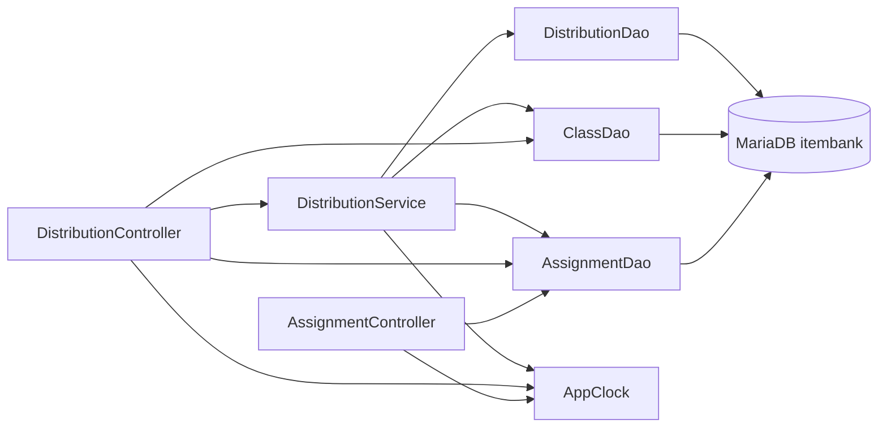

# legacy/assignment-thymeleaf 아키텍처

> 범위: 진입점 · 의존 관계 분석까지. 데이터 흐름 · 비즈니스 규칙은 아직 분석하지 않았다.
> 경로 약어: `J/` = `legacy/assignment-thymeleaf/src/main/java/com/example/assign/`,
> `T/` = `legacy/assignment-thymeleaf/src/main/resources/templates/`

## 1. 모듈 개요

- 과제 배포 관리 화면(Spring Boot `@SpringBootApplication` + Thymeleaf, 푸터 표기 v1.4.2)이다. (`J/AssignApplication.java:6`, `T/layout.html:35`)
- 계층은 Controller → Service → DAO(`JdbcTemplate`) 이고 MariaDB `itembank` 를 쓴다. (`legacy/assignment-thymeleaf/src/main/resources/application.properties:2`)
- 진입점은 GET 3개 · POST 2개 · `/` 리다이렉트 · DB 예외 처리 1개다.
- 서비스 로직 대부분이 `DistributionService.redistribute` 한 메서드(629줄)에 몰려 있다. (`J/service/DistributionService.java:72-700`)
- 테스트는 `AppClockTest` 하나뿐이다. (`legacy/assignment-thymeleaf/src/test/java/com/example/assign/AppClockTest.java`)

## 2. 폴더 구조

```
legacy/assignment-thymeleaf/
├── build.gradle · settings.gradle · Dockerfile · gradlew(.bat)
├── src/main/java/com/example/assign/
│   ├── AssignApplication.java        (12줄)  기동
│   ├── AppClock.java                 (28줄)  현재 시각 · 포맷
│   ├── web/
│   │   ├── AssignmentController.java   (35줄)
│   │   ├── DistributionController.java (101줄)
│   │   └── DbErrorAdvice.java          (18줄)
│   ├── service/
│   │   └── DistributionService.java    (701줄)
│   ├── dao/
│   │   ├── AssignmentDao.java    (66줄)
│   │   ├── ClassDao.java         (42줄)
│   │   └── DistributionDao.java  (108줄)
│   └── model/
│       ├── AssignmentRow.java (79줄) · ClassRow.java (32줄) · DistributionRow.java (97줄)
│       └── SubmissionRow.java (53줄) · RedistributeResult.java (89줄)
├── src/main/resources/
│   ├── application.properties (14줄)
│   └── templates/ layout · assignments · distributions · distribution_form · db_error (.html)
├── src/test/java/com/example/assign/AppClockTest.java (20줄)
├── build/      빌드 산출물 — 분석 제외
├── .gradle/    Gradle 캐시 — 분석 제외
└── gradle/     래퍼 — 분석 제외
```

## 3. 진입점 표

| URL · 화면 | 처음 실행되는 파일 | 부르는 주요 함수 | 반환 화면 |
|---|---|---|---|
| 애플리케이션 기동 | `J/AssignApplication.java:9` | `SpringApplication.run` (`:10`) | - |
| `GET /` | `J/web/AssignmentController.java:21` `home()` | 없음 | `redirect:/assignments` (`:23`) |
| `GET /assignments` 과제 목록 | `J/web/AssignmentController.java:26` `list()` | `AssignmentDao.findAllForList` (`:28`), `AppClock.now` (`:29`) | `assignments` (`:33`) |
| `GET /distributions` 배포 목록 | `J/web/DistributionController.java:32` `list()` | `DistributionService.listAll` (`:34`), `AppClock.now` (`:35`) | `distributions` (`:37`) |
| `GET /distributions/new` 새 배포 폼 | `J/web/DistributionController.java:40` `form()` | `AssignmentDao.findAllForSelect` (`:42`), `ClassDao.findAll` (`:43`), `AppClock.now` (`:44`) | `distribution_form` (`:46`) |
| `POST /distributions` 배포 등록 | `J/web/DistributionController.java:49` `create()` | `AssignmentDao.findById` (`:53`), `AppClock.now` (`:58`), `AppClock.fmt` (`:62`), `DistributionService.distribute` (`:67`) | `redirect:/distributions` (`:76`), 실패 시 `redirect:/distributions/new` (`:56`, `:63`, `:71`, `:74`) |
| `POST /distributions/{id}/redistribute` 재배포 | `J/web/DistributionController.java:79` `redistribute()` | `DistributionService.redistribute` (`:86`) | `redirect:/distributions` (`:89`, `:99`) |
| `DataAccessException` 전역 처리 | `J/web/DbErrorAdvice.java:11-12` `dbError()` | `System.out.println` (`:13`) | `db_error` (`:16`) |

원문 확인 (저장소 루트에서 실행, 표의 행 순서와 같음):

```bash
J=legacy/assignment-thymeleaf/src/main/java/com/example/assign
sed -n '9,11p'   $J/AssignApplication.java             # 애플리케이션 기동
sed -n '21,24p'  $J/web/AssignmentController.java      # GET /
sed -n '26,34p'  $J/web/AssignmentController.java      # GET /assignments
sed -n '32,38p'  $J/web/DistributionController.java    # GET /distributions
sed -n '40,47p'  $J/web/DistributionController.java    # GET /distributions/new
sed -n '49,77p'  $J/web/DistributionController.java    # POST /distributions
sed -n '79,100p' $J/web/DistributionController.java    # POST /distributions/{id}/redistribute
sed -n '11,17p'  $J/web/DbErrorAdvice.java             # DataAccessException 전역 처리
```

화면에서 POST 를 보내는 곳:

- 새 배포 폼 → `POST /distributions` (`T/distribution_form.html:8`)
- 배포 목록의 재배포 버튼 → `POST /distributions/{id}/redistribute` (`T/distributions.html:31`)

## 4. 의존 관계

"A → B" 는 A 가 B 를 호출하거나 포함한다는 뜻이다.



### 4.1 Java 호출

| A → B | 근거 |
|---|---|
| AssignmentController → AssignmentDao (생성자 주입) | `J/web/AssignmentController.java:17` |
| AssignmentController → AppClock.now | `J/web/AssignmentController.java:29` |
| DistributionController → DistributionService · AssignmentDao · ClassDao (생성자 주입) | `J/web/DistributionController.java:26` |
| DistributionController → AssignmentDao.findAllForSelect · findById | `J/web/DistributionController.java:42`, `:53` |
| DistributionController → ClassDao.findAll | `J/web/DistributionController.java:43` |
| DistributionController → DistributionService.listAll · distribute · redistribute | `J/web/DistributionController.java:34`, `:67`, `:86` |
| DistributionController → AppClock.now · fmt | `J/web/DistributionController.java:35`, `:44`, `:58`, `:62` |
| DistributionService → DistributionDao · AssignmentDao · ClassDao (생성자 주입) | `J/service/DistributionService.java:32` |
| DistributionService.listAll → DistributionDao.findAllForList | `J/service/DistributionService.java:39` |
| DistributionService.get → DistributionDao.findById | `J/service/DistributionService.java:43` |
| DistributionService.distribute → AssignmentDao.findById → ClassDao.findById → DistributionDao.countByAssignmentAndClass → nextId → insert | `J/service/DistributionService.java:48`, `:52`, `:59`, `:62`, `:63` |
| DistributionService.redistribute → DistributionDao.findById (2회) · findSubmissions · markRedistributed | `J/service/DistributionService.java:153`, `:631`, `:348`, `:620` |
| DistributionService.redistribute → AssignmentDao.findById · ClassDao.findById | `J/service/DistributionService.java:164`, `:239` |
| DistributionService → AppClock.now · fmt | `J/service/DistributionService.java:63`, `:77`, `:304`, `:426`, `:665` |
| AssignmentDao → JdbcTemplate (`assignment` LEFT JOIN `unit`, 하위 쿼리로 `distribution` 집계) | `J/dao/AssignmentDao.java:21-24`, `:31`, `:38`, `:43` |
| ClassDao → JdbcTemplate (`class`) | `J/dao/ClassDao.java:21`, `:25` |
| DistributionDao → JdbcTemplate (`distribution` · `assignment` · `class` · `submission`) | `J/dao/DistributionDao.java:23-29`, `:48`, `:55`, `:60`, `:66`, `:70` |

- `DistributionService.get()`(`J/service/DistributionService.java:42`)을 부르는 곳은 `main/java` 에서 찾지 못했다.

### 4.2 템플릿 포함 (Thymeleaf `th:replace`)

| A → B | 근거 |
|---|---|
| assignments.html → layout :: head · nav · flash · footer | `T/assignments.html:3`, `:5`, `:7`, `:34` |
| distributions.html → layout :: head · nav · flash · footer | `T/distributions.html:3`, `:5`, `:7`, `:44` |
| distribution_form.html → layout :: head · nav · flash · footer | `T/distribution_form.html:3`, `:5`, `:7`, `:32` |
| db_error.html → layout :: head · nav · footer (flash 없음) | `T/db_error.html:3`, `:5`, `:9` |
| layout :: nav → `/assignments` · `/distributions` · `/distributions/new` 링크 | `T/layout.html:24-26` |

## 5. 가장 긴 함수 3개

범위는 시그니처 줄부터 닫는 중괄호까지다.

| 순위 | 파일 | 함수 | 시작–끝 (줄 수) | 하는 일 |
|---|---|---|---|---|
| 1 | `J/service/DistributionService.java` | `redistribute(long, String, String)` | `:72`–`:700` (629줄) | 재배포를 처리한다. 한 메서드 안에 0~11 구간이 있다: 입력 정리(`:81`) → 배포 조회(`:152`) → 과제 상태(`:163`) → 학급(`:238`) → 마감 판정(`:264`) → 허용 판정(`:307`) → 제출 현황(`:347`) → 제출 유지 정책(`:483`) → 통계 문구(`:515`) → 상태 전환 요약(`:588`) → 플래그 갱신(`:619`) → 결과 메시지(`:641`). `@Transactional`(`:71`). |
| 2 | `J/web/DistributionController.java` | `create(long, long, RedirectAttributes)` | `:49`–`:77` (29줄) | 과제가 있는지 확인하고, 마감이 지난 과제는 연장(`"X"`) 상태가 아니면 막는다(`:60-64`). 그다음 `distribute` 를 호출하고 예외를 flash 메시지로 바꾼다(`:66-75`). |
| 3 (공동) | `J/service/DistributionService.java` | `distribute(long, long)` | `:47`–`:68` (22줄) | 과제와 학급이 있는지, 삭제(`"D"`) 상태가 아닌지, 이미 배포했는지 확인한다. 그다음 `MAX(id)+1` 로 id 를 정해 insert 한다. `@Transactional`(`:46`). |
| 3 (공동) | `J/web/DistributionController.java` | `redistribute(long, String, String, RedirectAttributes)` | `:79`–`:100` (22줄) | 서비스 `redistribute` 를 호출하고, 결과(ok · 메시지 · 경고)를 flash 로 옮긴다. |

1위의 "하는 일"은 구간 주석(`// ---------- n. … ----------`)만 보고 적었다. 각 구간의 실제 로직은 미확인이다.

## 6. 미확인 목록

- `DistributionService.redistribute` 본문 `:110`–`:700` 의 세부 로직. 구간 주석과 DAO · AppClock 호출 줄만 확인했다.
- 그 본문에서 `result` · `notes` · `warnings` 말고 다른 객체나 메서드를 부르는지.
- `model/*Row.java`, `RedistributeResult.java` 의 내용. import 만 확인했다.
- 템플릿 본문이 어떤 모델 속성을 쓰는지. `th:replace` · `th:action` · `th:href` 줄만 확인했다.
- `build.gradle` 의 의존성, `Dockerfile` 의 실행 방식.
- 스케줄러 · 필터 · 인터셉터 같은 다른 진입점이 있는지. `@Scheduled` · `CommandLineRunner` 키워드 검색에서만 나오지 않았다.
