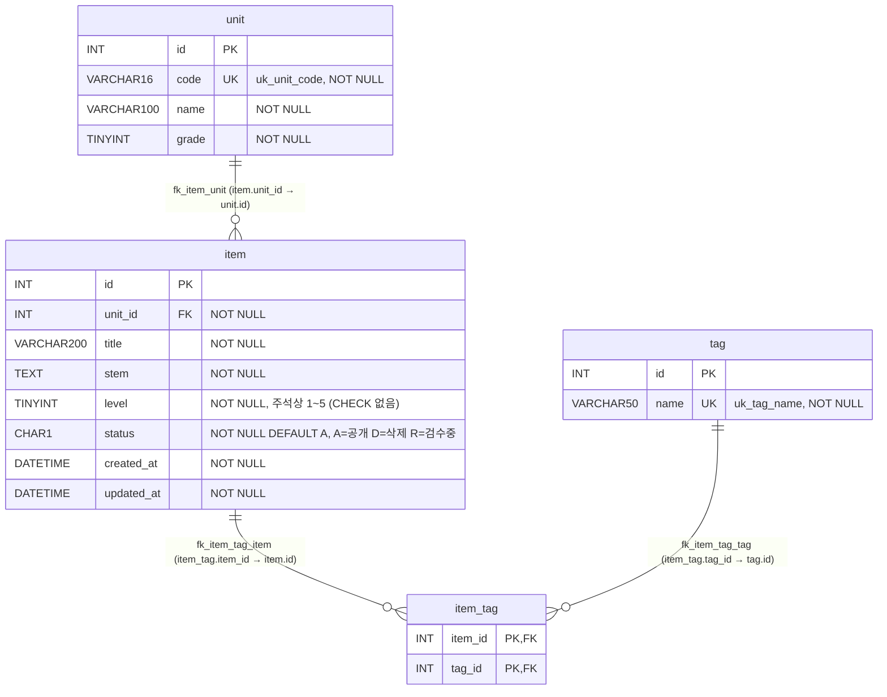

# item-bank ERD · 데이터 흐름 — 문항 검색 화면(`search.php`)

범위: `search.php` 가 읽는 테이블과 뷰만 다룹니다. 이 화면은 읽기만 하며 INSERT · UPDATE · DELETE 가 없습니다.
스키마 근거는 모두 `db/mariadb/init/01-schema.sql` 입니다.

## 1. 데이터 흐름

```
[입력] GET q · unit · level · tag · sort · dir · page             search.php:53-80
   │   배열로 들어오면 첫 값만 씁니다(reset)                        search.php:55 등
   ▼
[처리] buildSearchQuery
   ├─ 값 다듬기 · 검증 · 경고 수집                                  search.php:85-349
   ├─ WHERE 조립: 키워드 · 단원 · 난이도 · 태그                      search.php:98, :118, :215/:218/:226, :244-245
   ├─ ORDER BY 선택                                                search.php:276-327
   ├─ LIMIT 20 OFFSET (page-1)*20                                  search.php:349, :523
   └─ 보조 조회: unit(이름 · 선택 목록), tag(선택 목록)               search.php:125, :156, :178
   ▼
[조회] runSearchQuery — 같은 WHERE · 바인딩으로 두 번 실행합니다
   ├─ SELECT COUNT(*) AS cnt FROM v_item_public WHERE …             search.php:526
   └─ SELECT id, title, unit_code, level, tag_names, created_at
        FROM v_item_public WHERE … ORDER BY … LIMIT 20 OFFSET n     search.php:521-525
   ▼
[응답] HTML
   ├─ 경고 <ul id="warnings">, 조건 요약                             search.php:652-653
   ├─ <p id="count">검색 결과 N건</p>                                search.php:655
   ├─ 0건 → <p id="message">검색 결과가 없습니다</p>                  search.php:657-660
   ├─ <table id="items"> id · title · unit_code · level · tag_names  search.php:663-681
   └─ 페이지 링크(2페이지 이상일 때)                                  search.php:684-703
```

## 2. ERD



| 관계 | 근거 | 구분 |
|---|---|---|
| `item.unit_id` → `unit.id` | `01-schema.sql:32` | 스키마(FK) |
| `item_tag.item_id` → `item.id` | `01-schema.sql:46` | 스키마(FK) |
| `item_tag.tag_id` → `tag.id` | `01-schema.sql:47` | 스키마(FK) |
| `item_tag` 복합 PK `(item_id, tag_id)` | `01-schema.sql:45` | 스키마 |
| 검색 파라미터 `unit` ↔ `unit.code`(뷰의 `unit_code`) | `search.php:118`, `01-schema.sql:56` | 코드상 조인 키(스키마 제약은 `uk_unit_code` 까지) |
| 검색 파라미터 `tag` ↔ `tag.name` | `search.php:244-245`, `01-schema.sql:39` | 코드상 조인 키 |

- 스키마 파일에 없는 관계를 추정해서 넣지는 않았습니다.
- 모든 테이블의 기본 콜레이션은 `utf8mb4_unicode_ci` 입니다(`01-schema.sql:18`, `:33`, `:40`, `:48`). 그래서 `unit_code = ?`, `t.name = ?`, `LIKE` 비교는 대소문자를 구분하지 않을 것으로 **추정**합니다. 실제 DB 에서 실행해 보지는 않았습니다. 규칙 BR-05 · BR-07 에 영향을 줍니다.

## 3. 뷰 `v_item_public` (`01-schema.sql:52-70`)

| 뷰 컬럼 | 원천 | 검색 화면 사용 |
|---|---|---|
| `id` | `item.id` | SELECT · 정렬 · 태그 EXISTS 상관 조건(`search.php:245`) |
| `unit_id` | `item.unit_id` | 사용 안 함 |
| `unit_code` | `unit.code` | WHERE(`:118`) · SELECT · 정렬 |
| `unit_name` · `unit_grade` | `unit.name` · `unit.grade` | 사용 안 함. 단원 이름은 `unit` 을 따로 조회합니다(`:125`) |
| `title` | `item.title` | WHERE LIKE · SELECT · 정렬 |
| `stem` | `item.stem` | WHERE LIKE 만(`:98`) |
| `level` | `item.level` | WHERE · SELECT · 정렬 |
| `created_at` | `item.created_at` | SELECT · 정렬(`sort=created`) |
| `updated_at` | `item.updated_at` | 사용 안 함 |
| `tag_names` | `GROUP_CONCAT(t.name ORDER BY t.id SEPARATOR ',')` 상관 서브쿼리(`:64-67`) | SELECT · 표시(NULL 이면 빈 칸, `search.php:678`) |

- 필터: `WHERE i.status = 'A'`(`01-schema.sql:70`). 검색 결과에는 공개 문항만 나옵니다.
- `JOIN unit u ON u.id = i.unit_id`(`:69`)는 INNER JOIN 이지만 `item.unit_id` 가 `NOT NULL`(`:22`)이고 FK(`:32`)가 걸려 있습니다. 그래서 조인 때문에 빠지는 문항은 없습니다.
